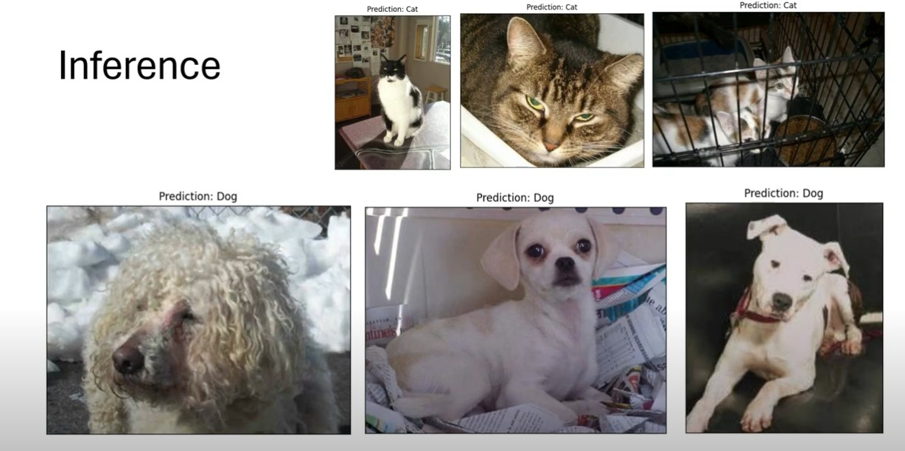

# PyTorch 猫狗图像分类与开放集识别

这是一个基于 PyTorch 和 torchvision 的图像分类项目，包含两个阶段：

1. **猫狗二分类**：判断输入图片是猫还是狗。
2. **开放集识别**：在猫、狗之外，识别图片是否属于未知类别。

项目默认使用冻结的 ImageNet 预训练 VGG16 作为特征提取器，并替换分类头。未知类别示例包括牛、马和兔子。



## 项目结构

```text
cat-dog-classification-pytorch/
├── data/                              # 本地数据集，不提交到 GitHub
│   ├── training_set/training_set/
│   │   ├── cats/                      # 猫训练图片
│   │   └── dogs/                      # 狗训练图片
│   ├── test_set/test_set/
│   │   ├── cats/                      # 猫测试图片
│   │   └── dogs/                      # 狗测试图片
│   └── unknown_set/                   # 开放集未知类别
│       ├── cow/
│       ├── horse/
│       └── rabbit/
├── models/                            # 训练得到的 .pth 文件，不提交到 GitHub
├── reports/                           # 评估生成的报告和图表，不提交到 GitHub
├── src/
│   ├── data_setup.py                  # 猫狗数据集和 DataLoader
│   ├── engine.py                      # 训练、验证和推理函数
│   ├── model.py                       # CNN、VGG16 和开放集模型
│   ├── ood.py                         # OOD 特征和距离计算
│   ├── openset_data.py                # 开放集数据读取与标签处理
│   ├── train.py                       # 猫狗二分类训练入口
│   ├── train_openset.py               # 猫/狗/未知三分类训练入口
│   └── utils.py                       # 模型保存和绘图工具
├── inference.py                       # 单张图片推理
├── evaluate_unknown.py                # 基于置信度的未知检测
├── evaluate_unknown_v2.py             # 基于特征距离的未知检测
├── evaluate_unknown_v3.py             # 开放集模型的未知检测
├── evaluate_ensemble.py               # 多种方法融合评估
├── download_unknown_images.py         # 未知类别图片下载工具
├── requirements.txt                   # Python 依赖
├── .gitignore
└── README.md
```

`data/`、`models/` 和 `reports/` 已在 `.gitignore` 中排除。克隆 GitHub 仓库后，需要自行准备数据集和模型权重。

## 环境安装

建议使用 Python 3.10 或更高版本，并在项目根目录执行：

```bash
python -m venv .venv
```

Windows：

```powershell
.\.venv\Scripts\Activate.ps1
pip install -r requirements.txt
```

Linux/macOS：

```bash
source .venv/bin/activate
pip install -r requirements.txt
```

如果安装了支持 CUDA 的 PyTorch，训练脚本会自动使用 GPU；否则使用 CPU。

## 数据集准备

### 猫狗数据集

猫狗数据集需要放置在以下路径：

```text
data/
├── training_set/training_set/cats/
├── training_set/training_set/dogs/
├── test_set/test_set/cats/
└── test_set/test_set/dogs/
```

图片文件名应包含 `cat` 或 `dog`，代码会根据文件名生成二分类标签：猫为 `0`，狗为 `1`。

### 未知类别数据集

开放集训练和评估需要额外准备：

```text
data/unknown_set/
├── cow/
├── horse/
└── rabbit/
```

未知类别不应放入 `training_set/cats` 或 `training_set/dogs`。普通二分类只使用猫狗数据；开放集脚本会把未知图片作为第 3 类 `unknown` 使用，并按比例划分训练集和验证集。

## 使用方法

### 1. 猫狗二分类训练

使用默认配置训练 20 个 epoch：

```bash
python src/train.py
```

自定义训练参数：

```bash
python src/train.py --batch_size 32 --learning_rate 0.001 --num_epochs 20 --model_name my-cat-dog-model.pth
```

训练后会生成：

```text
models/my-cat-dog-model.pth
my-cat-dog-model-metrics.npz
```

### 2. 开放集三分类训练

开放集模型的类别为：

```text
0 = cat
1 = dog
2 = unknown
```

运行：

```bash
python src/train_openset.py --epochs 6 --batch_size 32
```

如果希望将某个未知类别完全留作测试集，例如不让 `rabbit` 参与训练：

```bash
python src/train_openset.py --epochs 6 --holdout_unknown_classes rabbit
```

开放集模型默认保存到 `models/openset-vgg16.pth`，评估报告保存到 `reports/openset_v3/`。

### 3. 单张图片推理

使用二分类模型：

```bash
python inference.py --image path/to/image.jpg --method confidence
```

可用的未知检测方法：

```text
confidence    基于二分类置信度
mahalanobis   基于特征距离
openset       基于猫/狗/未知三分类模型
```

例如使用开放集模型：

```bash
python inference.py --image path/to/image.jpg --method openset --openset_weights models/openset-vgg16.pth
```

不提供 `--image` 时，脚本会从测试集中随机选择一张猫或狗图片。

### 4. 未知类别评估

```bash
python evaluate_unknown.py
python evaluate_unknown_v2.py
python evaluate_unknown_v3.py
python evaluate_ensemble.py
```

四个脚本分别进行置信度、特征距离、开放集模型和多方法融合评估。结果默认写入 `reports/`，包括 JSON 摘要、CSV 阈值扫描结果和直方图图片。

## 模型说明

### 猫狗二分类模型

- 默认模型：冻结 VGG16 主干 + 自定义二分类头
- 输入尺寸：`224 x 224 x 3`
- 输出：狗的概率，通常大于 `0.5` 判为狗，否则判为猫
- 损失函数：Binary Cross Entropy
- 优化器：Adam

项目还保留了轻量级 `SimpleBinaryClassifier` CNN，可在 `src/model.py` 中查看。

### 开放集模型

开放集模型使用 VGG16 主干和三分类头输出：

```text
P(cat), P(dog), P(unknown)
```

它与普通二分类模型不同，能够直接把非猫狗图片判为 `unknown`。

## 训练输出

训练和评估产生的文件包括：

- `*.pth`：模型权重
- `*-metrics.npz`：训练/验证损失和准确率
- `reports/**/*.json`：评估摘要
- `reports/**/*.csv`：阈值扫描结果
- `reports/**/*.png`：准确率、损失和分数分布图

这些文件默认不会被 Git 提交。模型文件如果需要发布，建议使用 Git LFS 或 GitHub Releases。

## 常见问题

- **找不到数据集**：确认当前命令在项目根目录执行，并检查 `data/` 的嵌套路径。
- **CUDA out of memory**：降低 `--batch_size`，例如改为 `16` 或 `8`。
- **找不到模型权重**：确认对应的 `.pth` 文件位于 `models/`，并检查推理命令中的路径。
- **未知类别效果不理想**：检查 `data/unknown_set/` 中的类别目录和图片数量，并重新运行开放集训练或评估。

## 许可证

本项目用于学习和研究。使用的数据集和预训练权重请遵守其各自的许可证和使用条款。
